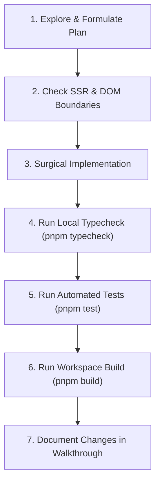

# AGENTS.md: Machine-Actionable Guide for AI Agents

> **Scope**: This document defines architectural principles, workspace topology, operational workflows, and agentic coding protocols for AI coding agents (Trae, Cursor, Copilot, Claude Code, Antigravity, Devin, Aider) working on the **MorphJS** repository.

---

## 1. Project Mission & Identity

**MorphJS** is the shortest, easiest, and most unified animation engine for modern web apps. It bridges the gap across fragmented animation ecosystems:
- **Motion.js**: Utilized for WAAPI hardware-accelerated compositor animations, physics-based springs, and pointer gestures.
- **Anime.js v4**: Utilized for ultra-compact UI timelines, SVG path morphing/drawing, and staggers.
- **GSAP v3**: Utilized for heavy-duty specialist workloads including `ScrollTrigger` (pinning & scrubbing) and complex polygon morphing (`MorphSVG`).

### Core Value Proposition
- **Shortest syntax on the web**: `morph('.box', { x: 100 }, 0.5)` (31 chars vs 42+ chars in legacy engines).
- **Agnostic & balanced**: No single engine dominates. MorphJS dynamically routes calls to the best-suited engine.
- **100% lazy-loaded**: If a project only uses springs and simple tweens, GSAP and Anime.js contribute **0 bytes** to the final bundle.
- **Zero-overhead fallbacks**: If optional peer dependencies are absent, execution gracefully degrades without throwing.

---

## 2. Workspace Topology & Package Architecture

MorphJS is organized as a `pnpm` monorepo defined in [pnpm-workspace.yaml](file:///d:/Project%20Trae/morphjs/pnpm-workspace.yaml).

```
morphjs/
├── packages/
│   ├── core/                  # Canonical full-featured package ("morphjs")
│   │   ├── src/
│   │   │   ├── adapters/      # Engine adapters (Motion, Anime, GSAP)
│   │   │   ├── api/           # Unified API methods (animate, spring, timeline, etc.)
│   │   │   ├── easing/        # Cubic-bezier, spring, and custom easing solvers
│   │   │   ├── events.ts      # Global animation lifecycle event bus
│   │   │   ├── router.ts      # Intelligent engine router based on targets & options
│   │   │   ├── state.ts       # Active animation registry & memory cleanup
│   │   │   └── types.ts       # Core TypeScript contracts and option interfaces
│   │   └── package.json       # Exports "morphjs"
│   │
│   ├── morph-stripped/        # Zero-overhead lightweight edition ("morph-stripped")
│   │   ├── src/
│   │   │   ├── api.ts         # Direct engine loaders (~7 KB gzip)
│   │   │   ├── engine.ts      # Streamlined engine loaders without registries
│   │   │   ├── types.ts       # Stripped types
│   │   │   └── index.ts       # Unified export entrypoint
│   │   └── package.json       # Exports "morph-stripped"
│   │
│   ├── react/                 # React bindings (@morphjs/react)
│   │   └── src/               # useAnimate, useMorphSpring, useGesture, MorphPresence
│   ├── vue/                   # Vue 3 bindings (@morphjs/vue)
│   │   └── src/               # useMorph, useMorphSpring, v-morph, MorphTransition
│   ├── svelte/                # Svelte bindings (@morphjs/svelte)
│   │   └── src/               # morphAction, gesture, morphTransition, springStore
│   └── tanstack/              # TanStack integration (@morphjs/tanstack)
│       └── src/               # Route transitions, table row animations, virtual lists
│
├── examples/
│   └── playground/            # Vite-powered interactive test harness
│
├── AGENTS.md                  # This file (Agentic instruction manual)
├── package.json               # Root workspace scripts & dev tooling
└── tsconfig.json              # Base TypeScript configuration
```

### Editions: `morphjs` vs `morph-stripped`
1. **`morph-stripped`** (`packages/morph-stripped`):
   - Direct lightweight loaders.
   - Omits event buses, state manager registries, and adapter registries to minimize bundle footprint (~23 KB raw / ~7 KB gzip).
2. **`morphjs`** (`packages/core`):
   - Full extensible architecture with dynamic adapter registration, `animationEvents` bus, and centralized `stateManager` tracking active tweens for global pause/resume/cleanup.

---

## 3. Canonical Workspace Commands

Always execute commands from the workspace root or pass `--filter <package-name>`:

| Task | Command | Notes |
| :--- | :--- | :--- |
| **Install Dependencies** | `pnpm install` | Uses `pnpm-lock.yaml` (pnpm v9+) |
| **Run Unit Tests** | `pnpm test` | Executes `vitest run` across all packages |
| **Run Typecheck** | `pnpm typecheck` | Executes `tsc --noEmit` across all workspace packages |
| **Build Packages** | `pnpm build` | Executes `vite build` in all packages and playground |
| **Run Linter** | `pnpm lint` | Runs `eslint .` |
| **Interactive Playground** | `pnpm --filter @morphjs/playground dev` | Starts Vite dev server at `http://localhost:5174/` |

---

## 4. Agentic Coding Protocols & Rules of Engagement

When tasked with modifying, refactoring, or extending code in this repository, you **MUST** adhere to the following agentic protocol:



### Protocol 1: Explore & Verify Boundaries First
- Read existing implementations before creating new utilities. Check whether functionality belongs in `packages/core` (extensible), `packages/morph-stripped` (compact), or framework wrappers.
- Never duplicate logic across packages without checking if a shared utility pattern exists.
- In monorepo packages, reference internal workspace dependencies using `"morphjs": "workspace:*"`.

### Protocol 2: Strict SSR & Environment Safety
MorphJS must work seamlessly across browser environments, Node.js SSR environments (Next.js, Nuxt, SvelteKit), and Vitest CLI test runners.
- **Never** directly reference browser globals (`window`, `document`, `NodeList`, `Element`, `SVGGeometryElement`) without guarding their existence.
- **Mandatory Guard Patterns**:
  ```ts
  // Checking window / document
  if (typeof window === 'undefined' || typeof document === 'undefined') {
    return createNoopControls();
  }

  // Checking NodeList safely
  const isNodeList = typeof NodeList !== 'undefined' && target instanceof NodeList;

  // Checking SVGGeometryElement safely
  if (typeof SVGGeometryElement !== 'undefined' && el instanceof SVGGeometryElement) {
    const length = el.getTotalLength ? el.getTotalLength() : 500;
  }
  ```

### Protocol 3: Package Export Integrity & Build Alignment
Each package in `packages/*` uses Vite with `vite-plugin-dts` to build library artifacts:
- **Build Output**:
  - ESM bundle: `dist/index.js`
  - CJS bundle: `dist/index.cjs`
  - TypeScript types: `dist/index.d.ts`
- **Package.json Invariant**:
  Ensure `package.json` always defines:
  ```json
  {
    "main": "dist/index.cjs",
    "module": "dist/index.js",
    "types": "dist/index.d.ts",
    "exports": {
      ".": {
        "types": "./dist/index.d.ts",
        "import": "./dist/index.js",
        "require": "./dist/index.cjs"
      }
    }
  }
  ```
  *Never point `package.json` to names like `dist/morphjs.js` if the bundler produces `dist/index.js`.*

### Protocol 4: Lazy Loading & Peer Dependency Handling
- All third-party engines (`motion`, `animejs`, `gsap`) are declared as **optional peer dependencies**:
  ```json
  "peerDependencies": {
    "animejs": ">=4.0.0",
    "motion": ">=11.0.0",
    "gsap": ">=3.12.0"
  },
  "peerDependenciesMeta": {
    "animejs": { "optional": true },
    "motion": { "optional": true },
    "gsap": { "optional": true }
  }
  ```
- Use dynamic `import()` or deferred loading wrappers (e.g. `createDeferred`, `loadMotion()`, `loadAnime()`, `loadGsap()`).
- Always handle module resolution failures gracefully. If an engine is not available, log a helpful warning or fallback to an available engine rather than crashing the consumer app.

### Protocol 5: Minimal Blast Radius & Zero Tree-Shaking Regressions
- Mark all publishable packages as `"sideEffects": false`.
- Do not import external CSS or heavy runtime helpers in core packages.
- Keep bundle size additions under scrutiny: changes to `morph-stripped` must be strictly measured to avoid bundle bloat.

---

## 5. API Architecture & Extension Reference

### 1. The Universal Morph Function
```ts
morph(target, keyframesOrProps, durationOrOptions)
```
- Short-form duration signature: `morph('.box', { x: 100 }, 0.5)`
- Full options signature: `morph('.box', { opacity: 0 }, { duration: 1, ease: 'easeOut', delay: 0.2 })`
- Sub-API access on `morph`:
  - `morph.animate(...)`
  - `morph.spring(...)`
  - `morph.timeline(...)`
  - `morph.stagger(...)`
  - `morph.scroll(...)`
  - `morph.gesture(...)`
  - `morph.svg` (`svg.draw`, `svg.morph`, `svg.attr`)

### 2. Standard `MorphControls` Contract
Every animation returns a unified controls object:
```ts
export interface MorphControls extends PromiseLike<void> {
  play(): void;
  pause(): void;
  reverse(): void;
  restart(): void;
  seek(progress: number): void;
  cancel(): void;
  duration: number;
  progress: number;
  then<TResult1 = void, TResult2 = never>(
    onfulfilled?: ((value: void) => TResult1 | PromiseLike<TResult1>) | null,
    onrejected?: ((reason: any) => TResult2 | PromiseLike<TResult2>) | null
  ): Promise<TResult1 | TResult2>;
}
```

### 3. Engine Selection Router (`packages/core/src/router.ts`)
The router selects the engine according to capability criteria:
- **GSAP**: Triggered if `options.engine === 'gsap'`, or if `pin: true` / `scrub: true` (ScrollTrigger), or vertex `morphPrecision` is set.
- **Anime.js**: Triggered if `options.engine === 'anime'`, or for SVG path manipulation (`d` property, path morphing, line drawing), or custom timelines.
- **Motion.js**: Default for standard CSS / WAAPI property tweens, physical spring dynamics (`options.spring` or `spring()`), and pointer gestures.

---

## 6. Known Traps & Self-Healing Playbook for Agents

### Trap 1: `ReferenceError: NodeList is not defined`
- **Cause**: In Vitest (Node.js default environment), DOM objects like `NodeList` are not declared on global scope.
- **Fix**: Replace `t instanceof NodeList` with `typeof NodeList !== 'undefined' && t instanceof NodeList`.

### Trap 2: `[commonjs--resolver] Failed to resolve entry for package`
- **Cause**: Package exports in `package.json` pointing to non-existent filenames (e.g., `dist/morphjs.js` instead of `dist/index.js`).
- **Fix**: Check `vite.config.ts` `lib.fileName` format, and ensure `main`, `module`, and `exports` in `package.json` match the emitted files exactly.

### Trap 3: Test Fails on Window or Document Access
- **Cause**: New API introduced without checking SSR / Node runner compatibility.
- **Fix**: Return `createNoopControls()` if `typeof window === 'undefined'` or `typeof document === 'undefined'`.

### Trap 4: Workspace Package Cross-Dependency Build Order
- **Cause**: Framework bindings or playground fail during build because dependent core packages have not yet emitted `dist/index.d.ts`.
- **Fix**: Run `pnpm build` at root; pnpm topological sorting automatically builds dependencies (`core`, `morph-stripped`) before consumers.

---

## 7. Verification Checklist Before Submitting Code

Before marking any task as complete, an AI agent must run and verify all three checks:

```powershell
# 1. Typecheck: must report 0 errors across all 7 workspace packages
pnpm typecheck

# 2. Test: must pass 100% of unit tests
pnpm test

# 3. Build: must successfully emit production bundles and declarations
pnpm build
```
